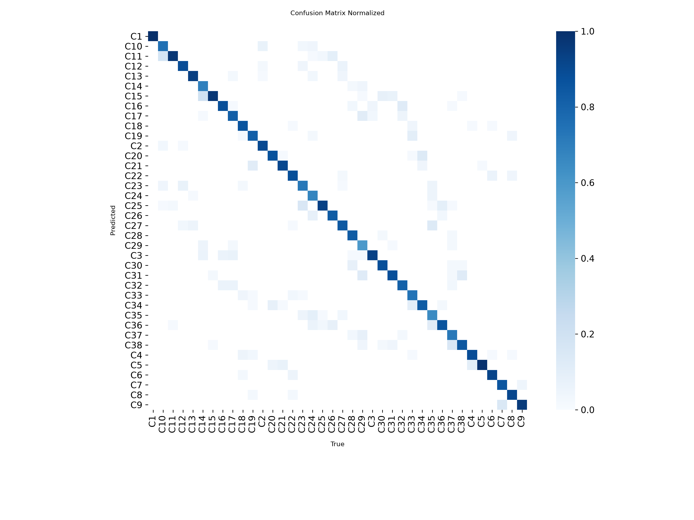
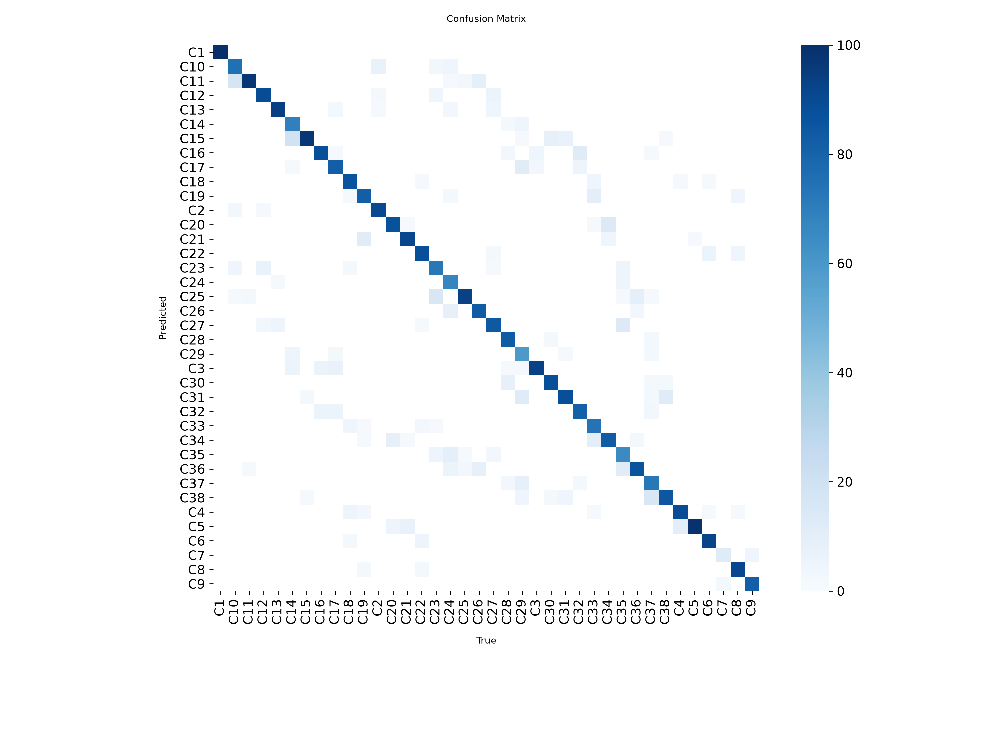

# Defect Detector

Prepare annotated images for object or defect detection, train a YOLO model, and run predictions. The general workflow accepts any product and any set of defect labels. A capacitor tray pipeline is retained as a worked example.

## Quick start

Requires Python 3.10 or newer.

```sh
git clone https://github.com/vantoan2905/Defect-Detector.git
cd Defect-Detector
python -m venv .venv
source .venv/bin/activate
pip install -e ".[yolo,dev]"
defectdet --help
```

For the Faster R-CNN example, install `.[frcnn]`. `pip install -r requirements.txt` installs all extras.

## General workflow

Put images (`.bmp`, `.png`, `.jpg`, `.jpeg`, `.tif` or `.tiff`) under one source folder. Each image needs a sibling Labelme JSON file with the same stem. Draw rectangles or polygons and give each object its intended class label, such as `scratch`, `dent` or `missing_part`. Shapes become YOLO bounding boxes. Nested folders are supported.

```text
data/raw/my_product/
├── image_001.png
├── image_001.json
├── image_002.png
└── image_002.json
```

Prepare overlapping tiles and a YOLO train/validation dataset:

```sh
defectdet prepare data/raw/my_product data/processed/defects \
  --tile-size 1024 --overlap 128 --val-fraction 0.2
```

The command discovers class names from the Labelme files and writes `images/{train,val}`, `labels/{train,val}` and `dataset.yaml`. It splits by original image, so tiles from one image stay in the same split. Boxes crossing a tile edge are clipped; `--min-visible` (default `0.5`) controls the minimum retained fraction. Empty tiles are kept as negative examples. Use a fresh output directory for each dataset build.

Edit [configs/defect_detector.yaml](configs/defect_detector.yaml) to select the model, dataset, image size and training settings. Then run:

```sh
defectdet train configs/defect_detector.yaml --device cpu
defectdet predict runs/defect_detector/train/weights/best.pt data/raw/my_product --conf 0.25
```

`train` accepts `--model`, `--data`, `--epochs`, `--batch` and `--device` overrides. The example config points to `data/processed/defects/dataset.yaml`. Dataset paths in the generated YAML are absolute; regenerate the dataset after moving it.

## Capacitor tray example

The original capacitor pipeline includes tray region detection, regular cell grids, defect spreadsheet merging, specialized tiling, Faster R-CNN and DeepStream deployment. It remains available through `capdet` and is documented in [docs/capacitor-example.md](docs/capacitor-example.md). Its sample configs are [configs/capacitor_detector.yaml](configs/capacitor_detector.yaml) and [configs/region_detector.yaml](configs/region_detector.yaml). The old `capacitor_detection` Python package and `capdet` command remain for existing scripts.

For a live RTSP camera on an NVIDIA GPU, see the [DeepStream RTSP flow](deploy/deepstream/README.md#live-rtsp-camera-general-defect-detector).

## Wafer classification trial: test output

The archive at `/mnt/d/archive` contains 52×52 wafer-map images with **38 image-level classes**. It has no bounding boxes, so this experiment trains a classifier rather than an object detector. The 37,015 images were split by map hash into 29,615 train, 3,700 validation and 3,700 test images, with no duplicate hash shared across splits.

YOLOv8n-cls was trained for 2 epochs at image size 64 on an RTX 5060 Laptop GPU. Evaluation of the best checkpoint on the independent test split produced:

| Test samples | Top-1 accuracy | Top-5 accuracy |
| ---: | ---: | ---: |
| 3,700 | **84.76%** | **99.89%** |

```text
                   all      0.848      0.999
TEST_TOP1 0.8475675582885742
TEST_TOP5 0.998918890953064
```

Local output files (under Git-ignored `runs/`):

| File | Contents |
| --- | --- |
| `runs/classify/runs/wafer_cls_v2/smoke/weights/best.pt` | Best classifier checkpoint |
| `runs/classify/runs/wafer_cls_v2/smoke/results.csv` | Per-epoch train and validation metrics |
| `runs/wafer_cls_v2/test_eval/metrics.json` | Test metrics |
| [`docs/assets/wafer-classification/confusion_matrix.png`](docs/assets/wafer-classification/confusion_matrix.png) | Test confusion matrix (tracked in Git) |
| [`docs/assets/wafer-classification/confusion_matrix_normalized.png`](docs/assets/wafer-classification/confusion_matrix_normalized.png) | Normalized test confusion matrix (tracked in Git) |

**Test confusion matrix (normalized)**



**Test confusion matrix (counts)**



See the [classification trial](docs/wafer-classification.md) for the preparation and training commands. The classifier checkpoint cannot be used directly as the RTSP detection model.

For task-specific `label`, `train`, `val`, `test` and model commands, see [scripts/README.md](scripts/README.md).

## Project structure

```text
configs/                 General and example YOLO training configs
data/                    Local datasets (ignored by Git; see data/README.md)
src/defect_detector/     General Labelme-to-YOLO preparation, training and CLI
src/capacitor_detection/ Capacitor example and compatibility wrapper
deploy/deepstream/       Capacitor example deployment
tests/                   Dataset and legacy pipeline checks
scripts/                 Detection, segmentation and classification workflows
```

## Development

```sh
pytest
ruff check src tests
```
